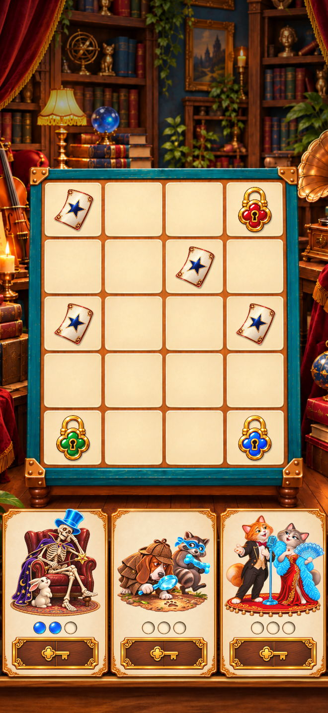
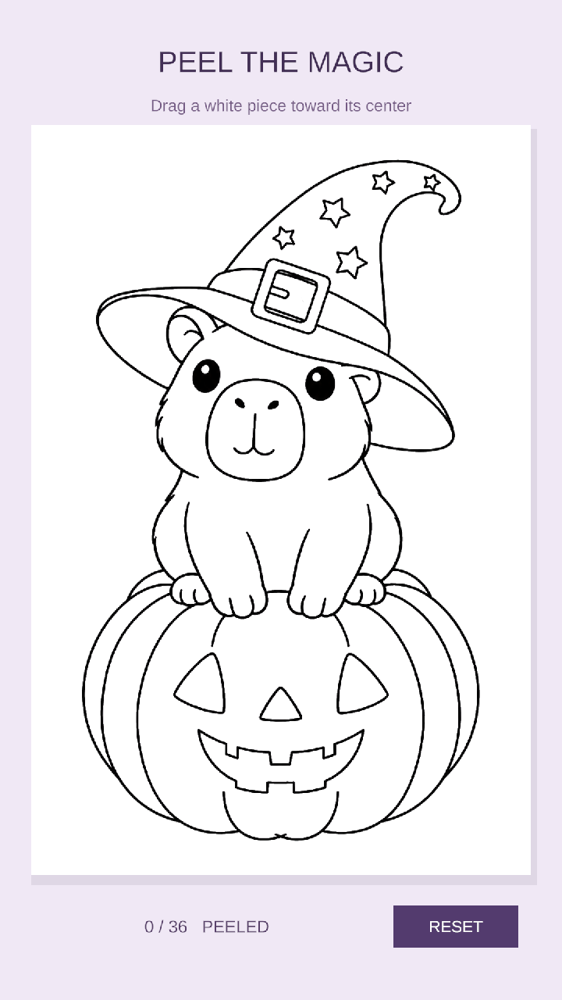

# Dima Rychka
### Game Design · Playable Prototypes · Unity

Three Unity projects exploring accessible game loops, visual feedback and hands-on interaction. My work spans game design, gameplay logic, concept sketches and UI/UX, with contributions detailed below.

## Selected projects

| Project | Design focus | My contribution | Unity |
| --- | --- | --- | --- |
| **Storage Auction 3** | Merge → collect → unlock; guided first actions; portrait interface | Game design, gameplay logic, sketches and storyboards that guided the gameplay | 6000.6.3f1 |
| **Glitter Peel!** | Peel → reveal → colour; gesture feedback; guided crafting | Game design, gameplay logic and sketches | 6000.6.7f1 |
| **4 in a Row** | Clear turn flow; computer opponent; readable board and feedback | Game design, gameplay logic, all graphics and UI/UX for the presented version | 6000.6.3f1 |

## Storage Auction 3

**A portrait merge prototype built around a compact reward loop.** Combine matching items, deliver upgraded pieces to a collection, then use a key to unlock the next stage. Hand hints guide the opening interactions; collection cards show progress toward a visible reward.

**What to review:** the first merge, the transition from item completion to a key reward, and the progression through three collections.

**My contribution:** game design, gameplay logic, sketches and storyboards that formed the basis for the gameplay.

[Source and design breakdown](https://github.com/dMortis/Storage-Auction-3)

## Glitter Peel!

*Image: an earlier capybara peel prototype. The project also includes a later flower level.*

**A tactile crafting prototype about peeling stickers and revealing adhesive areas.** The flower level introduces the gesture with three guided gold areas, then moves into free peeling and colour application. A separate sandbox explores spreading glitter and removing surplus material.

**What to review:** how the fold responds to dragging, how short gestures recover, and how the guided opening leads into free play.

**My contribution:** game design, gameplay logic and sketches.

[Source and design breakdown](https://github.com/dMortis/glitter-peel)

## 4 in a Row

**A turn-based board-game prototype with local play and a computer opponent.** A 7 × 6 board, animated piece drops, turn prompts and restart flow make the rules and current state visible.

**What to review:** choosing a game mode, taking a first turn, understanding the opponent's response, and restarting after a result.

**My contribution to the presented version:** game design, gameplay logic, all graphics and UI/UX.

**Original foundation:** [Dataloma/4InARow](https://github.com/Dataloma/4InARow), MIT License, copyright 2022 Dataloma. The original license is retained with the source.

[Source and design breakdown](https://github.com/dMortis/4-in-a-row)

## Review and delivery status

These are Unity prototypes for portfolio review. Each source package includes a project README, a design breakdown and the editor version needed to open it. Live browser demos have not been published as part of this portfolio preparation. Ad-network integration, delivery size and device performance have not been validated for an advertising campaign.

[GitHub profile](https://github.com/dMortis)
